<p align="center">
  
</p>

# OogVault Desktop

<p align="center">
  <a href="https://github.com/philippsyrov/OogVault">Browser extension</a> ·
  <a href="docs/MCP.md">Claude MCP setup</a> ·
  <a href="#screenshots">Screenshots</a>
</p>

<p align="center">
  <a href="docs/MCP.md"></a>
  <a href="https://github.com/philippsyrov/OogVault-Desktop"></a>
  <a href="LICENSE"></a>
  <a href="https://github.com/philippsyrov/OogVault"></a>
  
  
</p>

**Every AI chat you've saved, searchable in one hotkey. Local only.**

OogVault Desktop is the companion app for the [OogVault](https://github.com/philippsyrov/OogVault) browser extension. Browse your full conversation history, jump to anything with a Spotlight-style overlay, and let Claude Desktop query your vault through MCP — with no accounts, no cloud sync, and no telemetry.

<table>
<tr><td><b>Quick Search</b></td><td>Press <code>Cmd+Shift+Space</code> (or <code>Ctrl+Shift+Space</code>) from any app to search your vault instantly.</td></tr>
<tr><td><b>Full-window browser</b></td><td>Two-panel UI: conversation list on the left, full message thread on the right.</td></tr>
<tr><td><b>Menu bar presence</b></td><td>Lives in the macOS menu bar so the vault is always one click away.</td></tr>
<tr><td><b>Knowledge base</b></td><td>Imported chats are distilled into searchable Q&A nuggets, grouped by topic.</td></tr>
<tr><td><b>MCP for Claude</b></td><td>Expose your vault to Claude Desktop so it can search and recall past conversations. <a href="docs/MCP.md">Setup guide →</a></td></tr>
<tr><td><b>Import & export</b></td><td>One-click import from the extension JSON export; export threads as Markdown or the vault as JSON.</td></tr>
<tr><td><b>Private by design</b></td><td>Data stays on your machine in IndexedDB and a local snapshot file — the app makes no network requests.</td></tr>
</table>

---

## Quick start

Clone **both** repositories **side by side** (Desktop shares `lib/` with the extension):

```text
your-projects/
├── OogVault/              ← browser extension
└── OogVault-Desktop/      ← this repo (lib/ → ../OogVault/lib)
```

If `lib/` is missing after clone, link or copy it: `ln -s ../OogVault/lib lib`

## Getting started

```bash
# Node.js 18+ required
cd OogVault-Desktop
npm install          # install dependencies
npm start            # compile TypeScript and launch Electron

# Optional: build a macOS .app
npm run dist
```

After launch, use the menu bar icon or **`Cmd+Shift+Space`** for Quick Search. Import conversations from the extension via **Settings → Import from Extension** (export JSON from the extension first).

📖 **[Claude Desktop MCP setup →](docs/MCP.md)**

---

## Screenshots

<p align="center">
  
  
  
</p>

<p align="center">
  
  
</p>

---

<details>
<summary><b>Under the hood</b></summary>

```
OogVault extension (browser)
        │
        │  JSON export
        ▼
OogVault Desktop (Electron)
  ├── IndexedDB          ← conversations & messages (local)
  ├── Quick Search       ← global hotkey overlay
  ├── Knowledge base     ← auto-extracted Q&A nuggets
  └── vault-snapshot.json ──► MCP server ──► Claude Desktop
```

**Stack:** Electron 34, TypeScript (strict), vanilla DOM, IndexedDB, MCP over stdio.

**Data locations**

| Platform | Path |
|----------|------|
| macOS | `~/Library/Application Support/oogvault-desktop/` |
| Windows | `%APPDATA%\oogvault-desktop\` |
| Linux | `~/.config/oogvault-desktop/` |

**Import flow:** Extension **Settings → Export All** → Desktop **Settings → Import from Extension**.

**Known issue (macOS):** Copy/Open buttons in the Quick Search overlay can miss clicks on frameless transparent windows; click a result row to open in the main window, or press `Esc` to dismiss.

</details>

---

## License

MIT — see [LICENSE](LICENSE).

## Credits

Built by [Philipp Syrov](https://github.com/philippsyrov). Companion to [OogVault](https://github.com/philippsyrov/OogVault). MCP powered by the [Model Context Protocol](https://modelcontextprotocol.io).

<p align="center"><em>Search your vault first. Save the tokens.</em></p>
