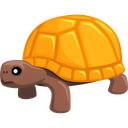

<p align="center">
  
</p>

<h1 align="center">OogVault Desktop</h1>

<p align="center">Every AI chat you've saved, searchable in one hotkey. Local only.</p>

<p align="center">
  <a href="https://github.com/philippsyrov/OogVault-Desktop/releases/latest"></a>
  
  <a href="LICENSE"></a>
</p>

<p align="center">
  <a href="#install">Install</a> ·
  <a href="docs/MCP.md">Claude MCP setup</a> ·
  <a href="https://github.com/philippsyrov/OogVault">Browser extension</a>
</p>

**OogVault Desktop is an Electron app that browses and searches the conversations you saved with the [OogVault](https://github.com/philippsyrov/OogVault) browser extension, and runs an MCP server so Claude Desktop can query the same vault.** Everything stays on your machine: no accounts, no cloud sync, no telemetry.

> [!NOTE]
> **Maintenance status:** OogVault is no longer maintained. I built it when Claude Code could only remember what was in `CLAUDE.md`. Coding agents now have proper built-in memory, so it is not needed anymore. The code still builds and the MCP server works, but the browser extension hooks into the web pages of Claude, ChatGPT and other chat sites, and those change often, so capture may need updating. Forks and PRs are welcome.

<p align="center">
  
  
  
</p>

<p align="center">
  
  
</p>

| Feature | What it does |
| --- | --- |
| **Quick Search** | `Cmd+Shift+Space` (or `Ctrl+Shift+Space`) opens a search overlay over your vault from any app. |
| **Conversation browser** | Two-panel window: conversation list on the left, the full message thread on the right. |
| **Menu bar icon** | Sits in the macOS menu bar so the vault is one click away. |
| **Knowledge base** | Distils imported chats into searchable Q&A nuggets, grouped by topic. |
| **MCP server for Claude** | Exposes the vault to Claude Desktop over stdio so it can search and fetch past conversations. See [docs/MCP.md](docs/MCP.md). |
| **Import and export** | Imports the extension's JSON export in one click; exports a thread as Markdown or the whole vault as JSON. |
| **Local only** | Data stays in IndexedDB and a local snapshot file; the app makes no network requests. |

## Install

A prebuilt Apple silicon build (`OogVault-0.1.1-arm64.dmg`) is on the [latest release](https://github.com/philippsyrov/OogVault-Desktop/releases/latest). It's unsigned, so on first launch right-click the app and pick **Open**.

To run from source:

```bash
# Node.js 18+
git clone https://github.com/philippsyrov/OogVault-Desktop.git
cd OogVault-Desktop
npm install          # install dependencies
npm start            # compile TypeScript and launch Electron

# Optional: build a macOS .app and .dmg into dist/
npm run build
```

After launch, use the menu bar icon or **`Cmd+Shift+Space`** for Quick Search. Import conversations from the extension via **Settings → Import from Extension** (export JSON from the extension first).

## Docs

| Doc | Covers |
| --- | --- |
| [docs/MCP.md](docs/MCP.md) | Claude Desktop MCP setup, available tools, troubleshooting |
| [docs/ARCHITECTURE.md](docs/ARCHITECTURE.md) | Data flow, stack, data locations, import flow, known issues |

## License

MIT, see [LICENSE](LICENSE).

Built by [Philipp Syrov](https://github.com/philippsyrov). Companion to [OogVault](https://github.com/philippsyrov/OogVault). MCP via the [Model Context Protocol](https://modelcontextprotocol.io).
