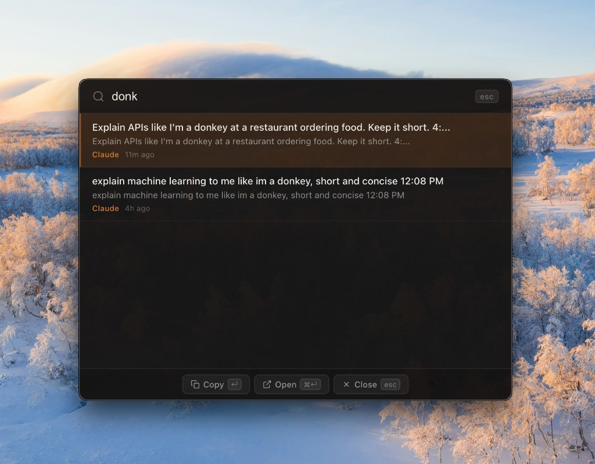
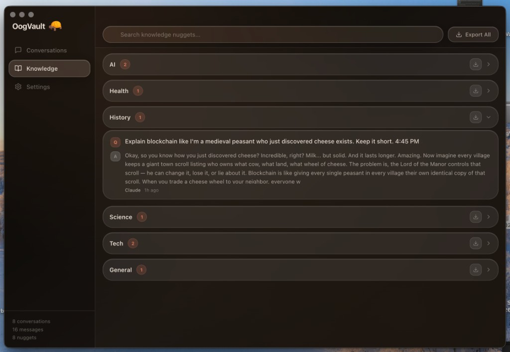
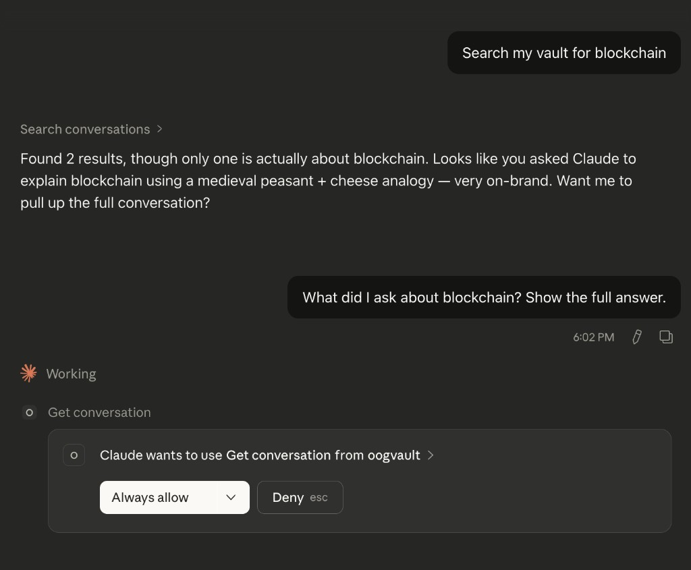
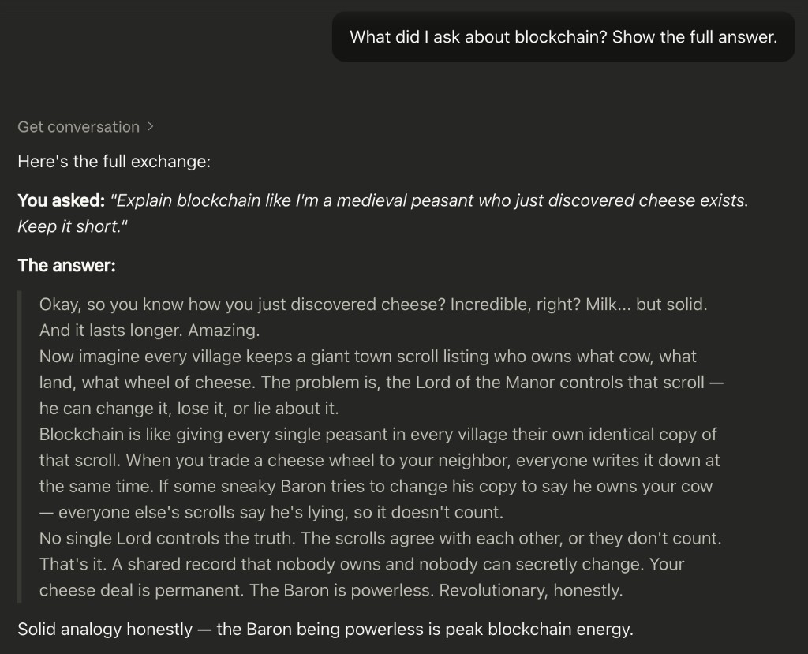

# OogVault Desktop

> Your AI conversation history — searchable, local, private.

A companion Electron desktop app for the [OogVault browser extension](https://github.com/PhilT3ch/OogVault). Import conversations from Claude, ChatGPT, and Gemini, then search and explore them — from a full-window UI, a Spotlight-style overlay, or directly inside Claude Desktop via MCP.

**100% local. No accounts. No cloud. No telemetry.**

---

## Features at a glance

### Quick Search overlay — `Cmd+Shift+Space` from anywhere

A Spotlight-style search popup that searches your entire vault in real time, without opening the main window.



Press `Cmd+Shift+Space` from anywhere on your Mac. Start typing. Arrow keys to navigate, click a result to open the full conversation.

---

### Knowledge Base — your conversations, distilled

Every conversation is automatically analysed and key Q&A pairs are extracted and categorised into topics (AI, Tech, Science, History, Finance, etc.).



Each nugget shows the original question and the best answer from the conversation. Search across all nuggets. Export as CSV.

---

### Claude Desktop MCP Integration — ask Claude about your past conversations

OogVault exposes your vault as an [MCP server](https://modelcontextprotocol.io). Claude Desktop can search your conversation history, retrieve full exchanges, and find similar past questions — all without you lifting a finger.

**Searching the vault from Claude Desktop:**



**Getting the full answer back:**



In the example above, a query for *"blockchain"* found the exact conversation where the user asked Claude to *"explain blockchain like I'm a medieval peasant who just discovered cheese"* — and Claude pulled up the full exchange, complete with its own editorial commentary (*"the Baron being powerless is peak blockchain energy"*).

---

## How it works

```
OogVault Extension (browser)
        │
        │  JSON export
        ▼
OogVault Desktop (Electron)
  ├── IndexedDB  ◄──── all conversations & messages (local, private)
  ├── Quick Search overlay  (Cmd+Shift+Space)
  ├── Knowledge base  (auto-extracted Q&A nuggets)
  └── vault-snapshot.json  ──► MCP Server ──► Claude Desktop
```

1. **Import** — export your conversations from the browser extension, import them into the desktop app in one click.
2. **Browse & Search** — full-window two-panel UI with fuzzy keyword search.
3. **Knowledge base** — conversations are parsed and nuggets (distilled Q&A pairs) are auto-extracted and categorised.
4. **Quick Search** — global hotkey opens a lightweight overlay. Search, navigate with arrows, click to open.
5. **MCP** — the app writes a `vault-snapshot.json` snapshot whenever data changes. The MCP server reads that file and exposes 5 tools to Claude Desktop. Works even when the desktop app is closed (uses the last snapshot).

---

## MCP Tools (for Claude Desktop)

| Tool | What it does |
|---|---|
| `search_conversations(query)` | Keyword + fuzzy search across all conversations |
| `check_if_asked_before(question)` | Find similar questions you've asked in the past |
| `get_conversation(id)` | Fetch the full conversation by ID |
| `search_knowledge_nuggets(topic)` | Search extracted Q&A pairs by topic |
| `list_recent_conversations(limit?)` | List most recent chats |

---

## Getting Started

### Prerequisites

- [Node.js](https://nodejs.org) v18+
- The [OogVault browser extension](https://github.com/PhilT3ch/OogVault) cloned **next to** this folder

```
your-projects/
├── OogVault/              ← browser extension repo
└── OogVault-Desktop/      ← this repo
```

> **Note on `lib/`:** The `lib/` folder is a copy of shared code from the extension (`db.js` + `search.js`). If it's missing, run `cp -r ../OogVault/lib ./lib` after cloning.

### Install & run

```bash
npm install
npm start
```

The app opens the main window and places an icon in your menu bar. Press `Cmd+Shift+Space` from anywhere to launch the quick search overlay.

### Build a distributable (macOS)

```bash
npm run dist
```

---

## Claude Desktop Setup

1. Open the desktop app at least once — it writes the initial vault snapshot to disk.
2. Find your Claude Desktop config file:
   - **macOS:** `~/Library/Application Support/Claude/claude_desktop_config.json`
   - **Windows:** `%APPDATA%\Claude\claude_desktop_config.json`
3. Add the OogVault server:

```json
{
  "mcpServers": {
    "oogvault": {
      "command": "/full/path/to/OogVault-Desktop/server/start-mcp.sh"
    }
  }
}
```

4. Restart Claude Desktop.
5. Try it: *"Search my vault for machine learning discussions"*

---

## Importing your conversations

1. Open the OogVault browser extension → **Settings** (gear icon)
2. Click **Export All** → saves a `.json` file
3. In the desktop app → **Settings** → **Import from Extension** → pick the file

---

## Project structure

```
OogVault-Desktop/
├── main.js             # Electron main process — windows, tray, IPC, shortcuts
├── preload.cjs         # contextBridge → window.electronAPI (CommonJS, required by Electron)
├── lib/                # Shared code: db.js (IndexedDB) + search.js (fuzzy search)
├── assets/
│   ├── icon.png / icon.icns
│   └── screenshots/
├── server/
│   ├── mcp-server.js   # MCP server (stdio, reads vault-snapshot.json)
│   └── start-mcp.sh    # Launch script for Claude Desktop config
└── renderer/
    ├── index.html          # Main app shell
    ├── app.js              # Entry point, view routing, shared utils
    ├── app.css             # Amber glass design system
    ├── quicksearch.html    # Quick search overlay
    ├── quicksearch.css
    ├── quicksearch.js
    └── views/
        ├── ConversationsView.js
        ├── KnowledgeView.js
        └── SettingsView.js
```

---

## Known Issues

### Quick Search footer buttons (Copy / Open) — macOS only

The **Copy** and **Open** buttons in the overlay footer, along with `Enter` / `Cmd+Enter` keyboard shortcuts, do not reliably fire on macOS.

**Why:** Frameless transparent Electron windows lose "key window" status when interactive elements are clicked. The `blur` event fires and hides the window before `mousedown` can complete.

**Workaround:** Click a search result directly to open it in the main window. Use `Esc` to close.

---

## Stack

Vanilla JS + CSS + Electron. No UI frameworks, no build tools, no cloud.

---

## Privacy

All data lives locally on your machine:
- **macOS:** `~/Library/Application Support/oogvault-desktop/`
- **Windows:** `%APPDATA%\oogvault-desktop\`

No network requests are ever made. No accounts required.
