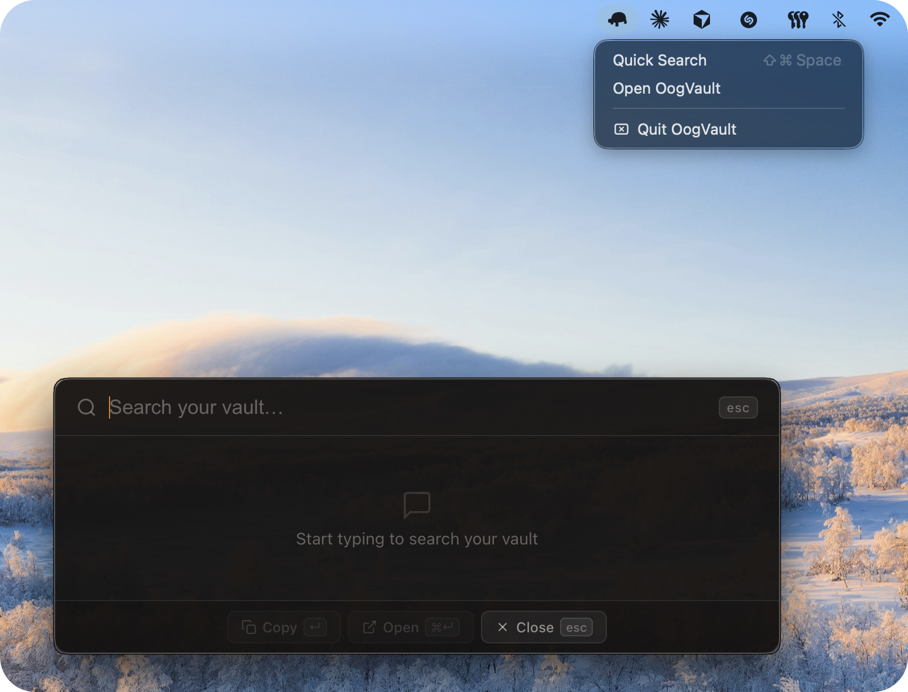

<h1 align="center">OogVault Desktop 🐢</h1>

<p align="center">
  <strong>"Yesterday is history, tomorrow's still a mystery, chats rest within the vault in secrecy."</strong>
</p>

<p align="center">
  <a href="#-features"></a>
  <a href="#-privacy"></a>
  
  <a href="LICENSE"></a>
</p>

<p align="center">
  <em>A companion desktop app for the <a href="https://github.com/philippsyrov/OogVault">OogVault browser extension</a>.<br/>
  Browse, search, and ask Claude about every AI conversation you've ever saved — all local, all private.</em>
</p>

---

## The Problem

The browser extension is great for capturing conversations while you're in the browser. But what about when you're not? What if you want to search your entire vault from anywhere on your Mac, or ask Claude to recall something you discussed three weeks ago?

## The Solution

**OogVault Desktop** brings your vault out of the browser and onto your desktop. A full-window UI to browse everything, a Spotlight-style overlay to search from anywhere with a hotkey, a knowledge base that auto-distills your conversations, and an MCP server so Claude Desktop can search your vault for you.

---

## ✨ Features

| Feature | Description |
|---------|-------------|
| **Full-Window UI** | Two-panel layout — conversation list on the left, full message thread on the right |
| **Quick Search Overlay** | Press `Cmd+Shift+Space` from anywhere on your Mac. Search your entire vault without opening the app |
| **Menu Bar Icon** | Lives quietly in your menu bar. Always one click away |
| **Knowledge Base** | Every conversation is automatically distilled into Q&A nuggets, auto-categorized by topic |
| **MCP Integration** | Exposes your vault as an MCP server so Claude Desktop can search, recall, and reference your past conversations |
| **Import from Extension** | One-click import via JSON export from the OogVault browser extension |
| **Export** | Conversations as Markdown, full vault as JSON |

---

## 📸 Screenshots

### Menu Bar & Quick Search — always one click or one hotkey away

> OogVault lives in your menu bar. Click the icon for instant access, or press `Cmd+Shift+Space` from anywhere to launch the search overlay without opening the main window.



---

### Quick Search in action

> Type any keyword and results appear instantly. Arrow keys to navigate, `Enter` to open, `Esc` to dismiss. Works from any app, any window.


---

### Knowledge Base — your conversations, distilled

> Every imported conversation is automatically analysed. Key Q&A pairs are extracted and sorted into topics — AI, Tech, Science, History, Health, and more. Search across all nuggets, or export any category.


---

### MCP Integration — ask Claude about your past conversations

> OogVault exposes your vault as an [MCP server](https://modelcontextprotocol.io). Claude Desktop can search your conversation history, retrieve full exchanges, and find similar past questions — all from natural language.


> In the example above, a simple *"Search my vault for blockchain"* found the exact conversation where the user asked Claude to explain blockchain like a medieval peasant who just discovered cheese — and pulled up the full answer on demand.

---

## 🔒 Privacy

All data lives locally on your machine. Always.

- **macOS:** `~/Library/Application Support/oogvault-desktop/`
- **Windows:** `%APPDATA%\oogvault-desktop\`

No network requests are ever made. No accounts, no sign-up, no telemetry. Zero.

---

## 🚀 Getting Started

### Prerequisites

- [Node.js](https://nodejs.org) v18+
- The [OogVault browser extension](https://github.com/philippsyrov/OogVault) cloned **next to** this folder

```
your-projects/
├── OogVault/              ← browser extension repo
└── OogVault-Desktop/      ← this repo
```

> **Note on `lib/`:** The `lib/` folder is shared code from the extension (`db.js` + `search.js`). If it's missing after cloning, run `cp -r ../OogVault/lib ./lib`.

### Install & run

```bash
npm install
npm start
```

The app opens the main window and places an icon in your menu bar. Press `Cmd+Shift+Space` from anywhere to launch the quick search overlay.

### Build a distributable (macOS)

```bash
npm run dist
```

---

## 📥 Importing your conversations

1. Open the OogVault browser extension → **Settings** (gear icon)
2. Click **Export All** — saves a `.json` file
3. In the desktop app → **Settings** → **Import from Extension** → pick the file

---

## 🤖 Claude Desktop MCP Setup

1. Open the desktop app at least once — it writes the initial vault snapshot to disk.
2. Find your Claude Desktop config file:
   - **macOS:** `~/Library/Application Support/Claude/claude_desktop_config.json`
   - **Windows:** `%APPDATA%\Claude\claude_desktop_config.json`
3. Add the OogVault MCP server:

```json
{
  "mcpServers": {
    "oogvault": {
      "command": "/full/path/to/OogVault-Desktop/server/start-mcp.sh"
    }
  }
}
```

4. Restart Claude Desktop.
5. Try it: *"Search my vault for machine learning discussions"*

### Available MCP Tools

| Tool | What it does |
|------|-------------|
| `search_conversations(query)` | Keyword + fuzzy search across all conversations |
| `check_if_asked_before(question)` | Find similar questions you've asked in the past |
| `get_conversation(id)` | Fetch the full conversation by ID |
| `search_knowledge_nuggets(topic)` | Search extracted Q&A pairs by topic |
| `list_recent_conversations(limit?)` | List most recent conversations |

---

## 🏗️ How it works

```
OogVault Extension (browser)
        │
        │  JSON export
        ▼
OogVault Desktop (Electron)
  ├── IndexedDB  ◄──── all conversations & messages (local, private)
  ├── Quick Search overlay  (Cmd+Shift+Space, global hotkey)
  ├── Knowledge base  (auto-extracted Q&A nuggets)
  └── vault-snapshot.json  ──► MCP Server ──► Claude Desktop
```

---

## 🏛️ Project Structure

```
OogVault-Desktop/
├── main.js             # Electron main process — windows, tray, IPC, shortcuts
├── preload.cjs         # contextBridge → window.electronAPI
├── lib/                # Shared code: db.js + search.js (from extension)
├── assets/
│   ├── icon.png / icon.icns
│   └── screenshots/
├── server/
│   ├── mcp-server.js   # MCP server (stdio, reads vault-snapshot.json)
│   └── start-mcp.sh    # Launch script for Claude Desktop
└── renderer/
    ├── index.html
    ├── app.js
    ├── app.css
    ├── quicksearch.html / .css / .js
    └── views/
        ├── ConversationsView.js
        ├── KnowledgeView.js
        └── SettingsView.js
```

---

## 🛠️ Tech Stack

- **Electron 34** — cross-platform desktop shell
- **TypeScript (strict)** — vanilla DOM, no frameworks
- **IndexedDB** — local persistent storage
- **MCP (stdio)** — Claude Desktop integration via Model Context Protocol

---

## ⚠️ Known Issues

### Quick Search footer buttons — macOS only

The **Copy** and **Open** buttons in the overlay, along with `Enter` / `Cmd+Enter` shortcuts, may not reliably fire on macOS. This is an Electron limitation — frameless transparent windows lose focus before `mousedown` can complete.

**Workaround:** Click a result directly to open it in the main window. Use `Esc` to close.

---

## 🗺️ Roadmap

- [x] Full-window two-panel UI (browse + search)
- [x] Quick Search overlay with global hotkey
- [x] Menu bar icon
- [x] Knowledge base with topic categorization
- [x] MCP server for Claude Desktop integration
- [x] Import from browser extension
- [ ] Windows build & testing
- [ ] Auto-sync with browser extension (no manual export needed)

---

## 📄 License

MIT — free to use, modify, and distribute.

---

<p align="center">
  <em>"There are no accidents."</em> — Master Oogway <em>(probably)</em>
</p>

<p align="center">
  <strong>🐢 Search your vault first. Save the tokens.</strong>
</p>
